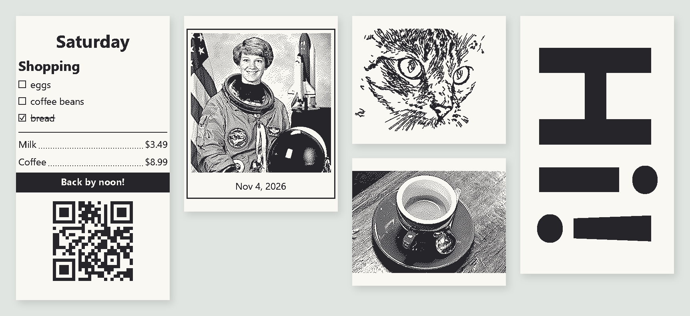
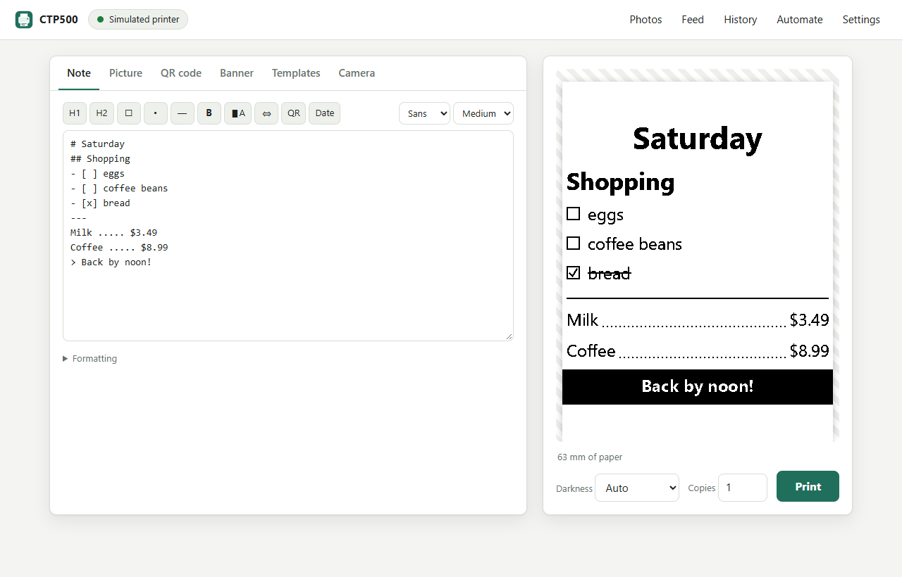
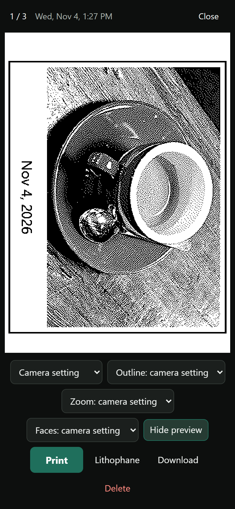
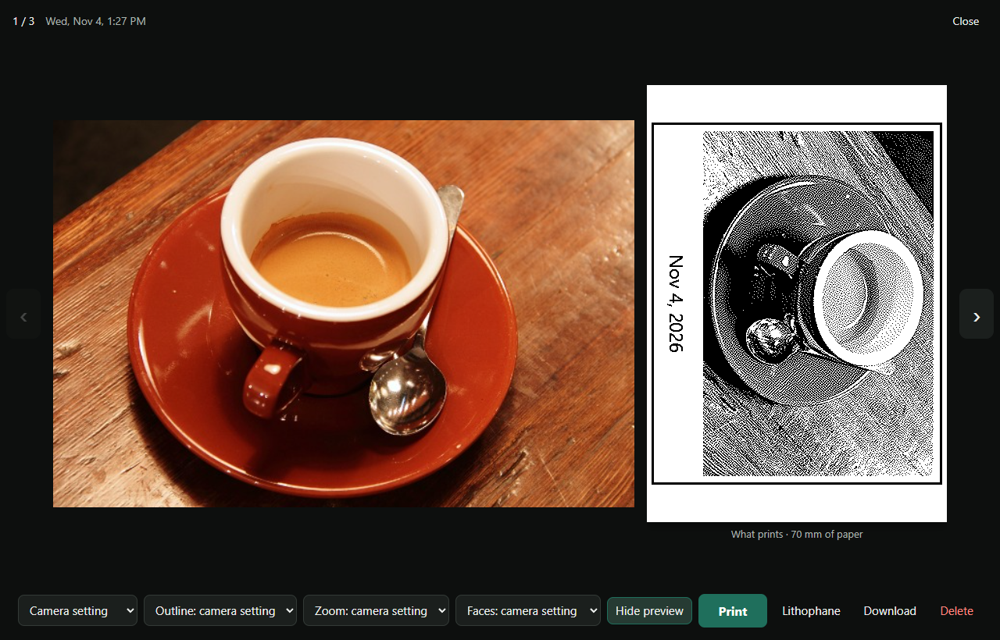
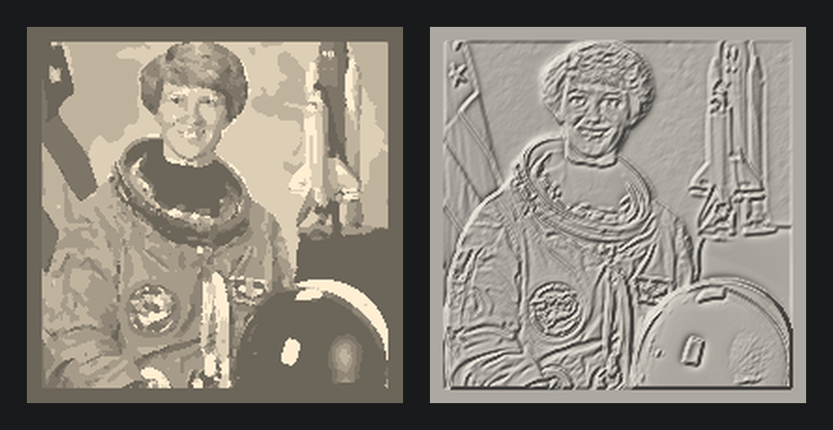

# CTP500 Print Server

Your own app for the **CTP500 Bluetooth thermal printer** (the pocket thermal printer sold by Core Innovations):
a print server for a Raspberry Pi, a web app for any phone or computer, an instant-camera app for the
**Adafruit MEMENTO**, a command line, and an HTTP API for automations. No account, no cloud, no app store.



<sub>Every picture here is the exact dots the printer gets, drawn by this app. Photos: scikit-image's samples
(NASA, public domain; CC0).</sub>

- **Notes, pictures, QR codes, banners and templates**, with a live preview of the exact dots before anything prints.
- **Photos that look good on thermal paper:** dehazing, face-aware tones and Atkinson dithering tuned on real
  prints, plus AI line drawings that keep faces.
- **An instant camera:** shoot on a MEMENTO and it prints; every photo also lands in the server's photo gallery.
- **Lithophanes and relief plaques** for a 3D printer, from any photo.
- **Printer alerts:** out of paper or lid open? The print waits, retries, and can send your phone a notification.
- **Automations:** Home Assistant, scripts, `curl`: anything that can send an HTTP request can print.

```
 phone / computer / Home Assistant ──┐
 MEMENTO camera ──── Wi-Fi ──────────┼──▶ Raspberry Pi: print server ──Bluetooth──▶ CTP500
 Windows PC helper (optional) ───────┘
```

## What you need

| | |
|---|---|
| **Printer** | A CTP500. Some speak the "cat printer" protocol (tested; they show up as `Mini Printer-…`), others ESC/POS; the server works out which. |
| **Server** | A Raspberry Pi with Bluetooth (tested: Pi 5 on 64-bit Raspberry Pi OS / Debian 13), or any Debian-style Linux with Bluetooth and Python 3.10+. |
| **Camera** (optional) | An [Adafruit MEMENTO](https://www.adafruit.com/product/5420) (product 5420: ESP32-S3 + OV5640 autofocus camera), a microSD card and a LiPo battery. [Guide](camera/README.md) |
| **Print box** (optional) | An ESP32-S3 "N16R8" board on a USB power bank: prints camera and phone photos away from home. [Guide](esp32/README.md) |
| **PC helper** (optional) | A Windows PC, ideally with an NVIDIA graphics card: faster drawings, face sharpening, ready-to-print 3D files. [Guide](desktop/README.md) |
| **3D printer** (optional) | Any FDM printer takes the lithophane STLs; ready-to-print files are for a Bambu Lab A1 mini. |

## Quick start

On the Raspberry Pi (in a terminal, or over SSH):

```sh
sudo apt install -y git
git clone https://github.com/jamesccupps/CTP500-Print-Server.git ~/ctp500
~/ctp500/pi/install.sh
```

Switch the printer on first, and close its phone app (the printer takes one connection at a time). The installer
sets up everything (packages, the AI models, a service that starts with the Pi), finds the printer, pairs it, and
ends with the web app's address:

```
Ready. Open the web app on any phone or computer on this network:
    http://192.168.1.50:8500    (or http://raspberrypi.local:8500)
```

Open it, type a note, press **Print**. No printer yet? It runs with a simulated one (prints show up in History);
run the installer again once the printer is on, or give its address: `~/ctp500/pi/install.sh AA:BB:CC:DD:EE:FF`
(`python3 -m ctp500 find` lists nearby printers).

**Lock it down:** out of the box anyone on your network can print and see the photos. To require a token:

```sh
cd ~/ctp500 && python3 -m ctp500 config token=$(python3 -c "import secrets; print(secrets.token_hex(16))")
sudo systemctl restart ctp500
```

The first command shows the token. The web app asks for it once per browser; scripts send
`Authorization: Bearer <token>`. To use it away from home,
[Tailscale](https://tailscale.com) on the Pi and your phone works well.

**Update:** `cd ~/ctp500 && git pull && ./pi/install.sh` (your settings and photos stay).

## The web app



- **Note:** type and print. [Simple formatting](#note-formatting), a live preview of the exact dots, Ctrl+Enter
  prints.
- **Picture:** drop, paste (Ctrl+V) or choose a picture. Photo styles tuned for thermal paper (Photo, Photo +
  outlines, fine dots, crisp, black and white) and drawing styles (line drawing, artist sketch, pencil sketch,
  coloring page, poster, halftone, pen hatching), with detail, line weight, brightness, contrast, sideways
  printing and text above or below. Line drawings, sketches and coloring pages are drawn by an AI model.
- **QR code:** a link, text, or a Wi-Fi network your guests can scan. **Banner:** huge letters along the paper.
- **Templates:** to-do, shopping list, sticky note, daily plan, receipt, label, message, Wi-Fi card.
- **History:** everything printed, with reprint. **Automate:** copy-paste examples with your server's address.
- **Settings:** blank paper above and below prints, photo tones (Punchy / Even), and how camera photos print, with
  a live preview of your newest photo.

### Photos



`http://<pi>:8500/photos` (or **Photos** in the app's header) holds every photo from the camera and every upload,
grouped by day.

- **Preview print** shows exactly what will print (in the camera's style, or pick another); **Print** gives you 3 s
  to change your mind. **Download**, **Delete**, **Download all** (one zip).
- **Take photo** on a phone opens its camera: the shot uploads and opens one tap from Print. **Upload** (or drop
  files on the page) adds photos from anywhere.
- **Faces:** small faces are drawn again from a close crop so they get eyes and a mouth; the tones are set so faces
  print well; **Zoom in on faces** crops to the people; **Sharpen faces** (with the [PC helper](desktop/README.md))
  redraws soft faces sharp.



### Lithophanes and relief plaques



In the Photos viewer, **Lithophane** turns the photo into a thin panel that shows the picture when light shines
through it (left), or a **relief plaque**, a carving where nearer things stand out (right). Pick 60 / 80 / 110 mm
and **Flat** (for a window or a lamp), **Curved** (stands up by itself; light it with an LED tea light, never a
candle) or **Relief**, then **Download 3D file** (an STL).

Made for quick prints: lithophanes are 0.68–2.12 mm thick in whole 0.24 mm layers. In Bambu Studio pick **0.24mm
Draft**, **Sparse infill 100%**, **Wall loops 1**, white PLA. On an A1 mini (with its ~6 min warm-up): flat 60 / 80 /
110 mm = 18 / 26 / 41 min, curved 29 / 39 / 55 min. Relief plaques: any color, 0.20mm Standard, 36 / 55 / 90 min.
With the PC helper and Bambu Studio, **Ready to print** hands you a file already sliced for the A1 mini.

### Printer alerts

When a print can't go out (out of paper, lid open, printer off or out of range) it **waits** instead of failing:
the server tries again every 20 s for up to 30 minutes, the app shows "Waiting: …", and you can cancel it from
History. Set `notify_url` and the server also POSTs `{"title": …, "message": …}` there (e.g. a Home Assistant
webhook that sends it to your phone): once when prints start waiting, and again when they go out or give up.

## The camera, the print box and the PC helper

- **[Camera app](camera/README.md):** an Adafruit MEMENTO as an instant camera. `python camera/install.py` sets it
  up: Wi-Fi, the server's address, the libraries and the app.
- **[Print box](esp32/README.md):** an ESP32-S3 next to the printer that makes its own Wi-Fi network, for printing
  camera and phone photos away from home (over Bluetooth LE).
- **[PC helper](desktop/README.md):** a Windows PC takes the heavy jobs while it's on: AI drawings in 0.05 s instead
  of ~2.5 s, face sharpening, ready-to-print lithophanes. One command:
  `powershell -ExecutionPolicy Bypass -File desktop\install.ps1 -Server http://<pi>:8500`.

## Note formatting

| Type | Get |
|---|---|
| `# Title` / `## Sub` / `### Small` | headings (`#` is big and centered) |
| `- [ ] eggs` / `- [x] eggs` | checkbox / ticked and struck through |
| `- eggs` | bullet |
| `---` / `- - -` / `===` | line / dashed / thick |
| `**whole line**` | bold |
| `> Note` | white text on a black bar |
| `Milk ..... $3.49` | left and right with a dotted leader (4+ dots) |
| `[qr] https://…` | QR code |
| `[banner] HELLO` | sideways banner |
| `[center]` `[right]` `[big]` `[small]` `[huge]` `[mono]` `[serif]` `[bold]` | style one line (combine them) |
| `{date}` `{time}` `{datetime}` `{weekday}` `{year}` | filled in when it prints |

## Automations

The [HTTP API](docs/API.md) has everything the web app does. For example:

```sh
curl --data-binary "# Laundry
The dryer finished at {time}" http://<pi>:8500/api/print/text
```

Home Assistant: a `rest_command` ([example](docs/API.md#home-assistant)) lets any automation print.

**Command line**, on any computer with Python 3.10+ (`pip install -r requirements.txt`):

```sh
python -m ctp500 config server=http://<pi>:8500   # once
python -m ctp500 text "# Hello" "- [ ] world"
python -m ctp500 image photo.jpg --style photo
python -m ctp500 qr https://example.com --caption "Scan me"
python -m ctp500 banner HAPPY BIRTHDAY
python -m ctp500 --preview out.png text "check the layout without printing"
```

On a computer with working Bluetooth, `--printer AA:BB:CC:DD:EE:FF` prints directly without a server.

## Settings

`~/.config/ctp500/config.json` on the Pi. Change one with `cd ~/ctp500 && python3 -m ctp500 config key=value`, then
`sudo systemctl restart ctp500`. Most of the photo settings are also in the web app's **Settings**.

| Setting | |
|---|---|
| `printer`, `protocol` | the printer's Bluetooth address; `auto` (default), `cat` or `escpos` |
| `port`, `token` | the web app's port (8500); a token to require (above) |
| `darkness`, `feed`, `padding_top_mm`, `padding_bottom_mm` | print darkness; paper fed at the end; blank paper around prints (6 mm) |
| `photo_look` | `punchy` (default: clean light areas, bold shadows) or `even` (more gray steps, prints at Light) |
| `camera_style`, `camera_detail`, `camera_weight`, `camera_frame`, `camera_sideways`, `camera_caption`, `camera_zoom`, `camera_sharpen` | how camera photos print |
| `camera_stuck_pixel` | `[x, y]` (shares of width and height) of a stuck bright sensor pixel to paint out of camera shots |
| `keep_alive`, `retry_minutes`, `notify_url` | seconds to hold the Bluetooth connection after a job (45); how long a waiting print retries (30); where to send alerts |
| `data_dir` | where photos and history live |

## Troubleshooting

- **The installer finds no printer:** is it on, and not connected to the phone app? Run
  `cd ~/ctp500 && python3 -m ctp500 find` and use the address it lists: `./pi/install.sh AA:BB:CC:DD:EE:FF`.
- **Prints come out blank:** the printer speaks the other dialect. `python3 -m ctp500 config protocol=cat` (or
  `escpos`), then `sudo systemctl restart ctp500`.
- **A print says "Waiting":** out of paper, lid open, or the printer is off or out of range. Fix it and the print
  goes out by itself (for 30 minutes), or cancel it in History.
- **No AI styles** (line drawings look like plain edges): `cd ~/ctp500 && .venv/bin/python -m ctp500 models`. The AI
  needs a 64-bit OS.
- **The web app doesn't open:** `systemctl status ctp500` and `journalctl -u ctp500 -f` show what's wrong.

## How it works

The Pi holds a classic Bluetooth serial connection (RFCOMM) to the printer while there's a job, and lets go 45 s
later so the phone app can still use it. Every print is drawn as one 384-dot-wide, 1-bit picture (8 dots per mm)
and sent in the printer's own dialect. Photos are prepared for this printer's dot gain, measured from a printed
calibration strip (`tools/calibration_strip.py`): Normal, Dark and Darkest print the same and merge everything past
~60% gray into black, so the Punchy look lifts midtones and Even prints at Light. Before each print the server asks
the printer's state, so an empty roll or an open lid fails with a reason instead of losing the print.

Tests: `python -m unittest discover -s tests` (Windows and Linux).

## Credits and licenses

MIT licensed (see [LICENSE](LICENSE)).

Printer protocol: [thirtythreedown/CTP500PrinterApp](https://github.com/thirtythreedown/CTP500PrinterApp),
[parkerlreed's gist](https://gist.github.com/parkerlreed/8f77bdb08e260b5d0fe795e70d8fd6b0),
[Dejniel/TiMini-Print](https://github.com/Dejniel/TiMini-Print) and
[NaitLee/Cat-Printer](https://github.com/NaitLee/Cat-Printer).

AI models, downloaded on first use and checked against pinned SHA-256s (none are included here):

| Model | Used for | License |
|---|---|---|
| [Informative Drawings](https://github.com/carolineec/informative-drawings) (Chan, Durand, Isola; ONNX by [rocca](https://huggingface.co/rocca/informative-drawings-line-art-onnx) and [backnotprop](https://huggingface.co/backnotprop/informative-drawings-image-to-opensketch-onnx)) | line drawings, sketches | MIT |
| [YuNet](https://github.com/opencv/opencv_zoo/tree/main/models/face_detection_yunet) (OpenCV Zoo) | finding faces | MIT |
| [Depth Anything V2 Small](https://huggingface.co/onnx-community/depth-anything-v2-small) | relief plaques | Apache-2.0 |
| [GFPGAN v1.4](https://github.com/TencentARC/GFPGAN) (ONNX by [FaceFusion](https://github.com/facefusion/facefusion-assets)) | sharpening faces (PC helper) | Apache-2.0 |

The camera app runs on Adafruit's CircuitPython libraries (MIT); the print box uses
[NimBLE-Arduino](https://github.com/h2zero/NimBLE-Arduino) and [JPEGDEC](https://github.com/bitbank2/JPEGDEC)
(both Apache-2.0). CTP500, MEMENTO and Bambu Lab are their owners' trademarks; this project isn't affiliated with
any of them.
